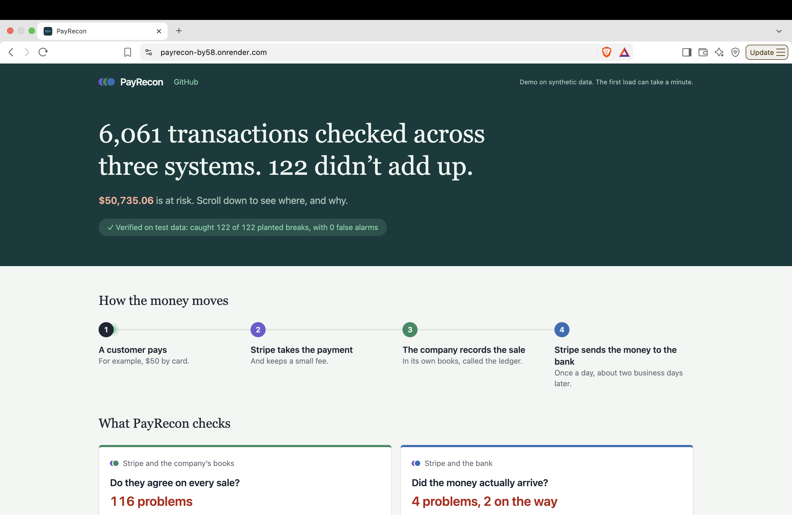
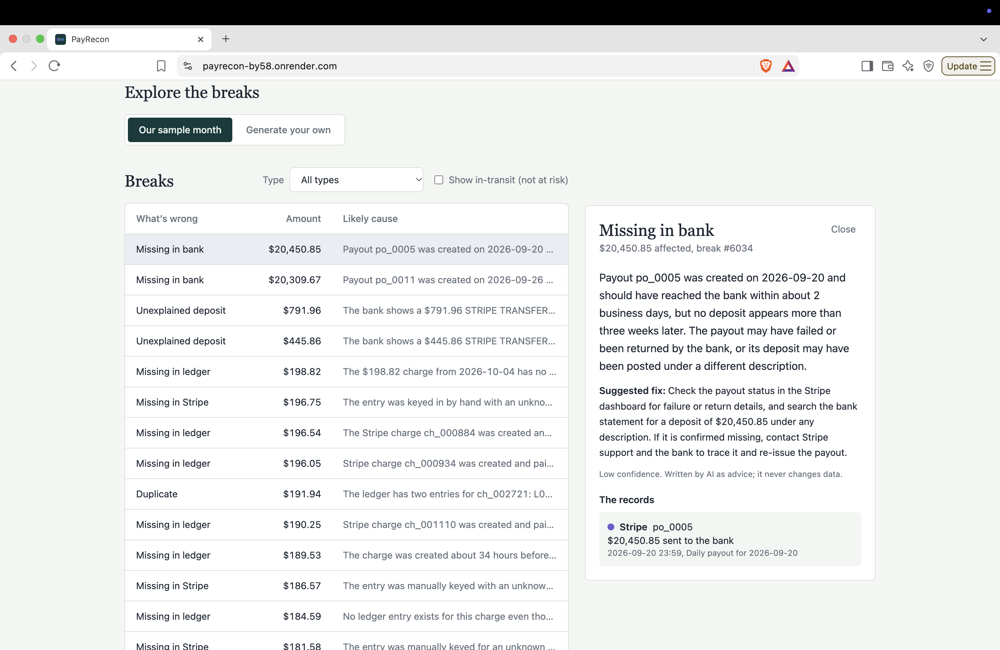
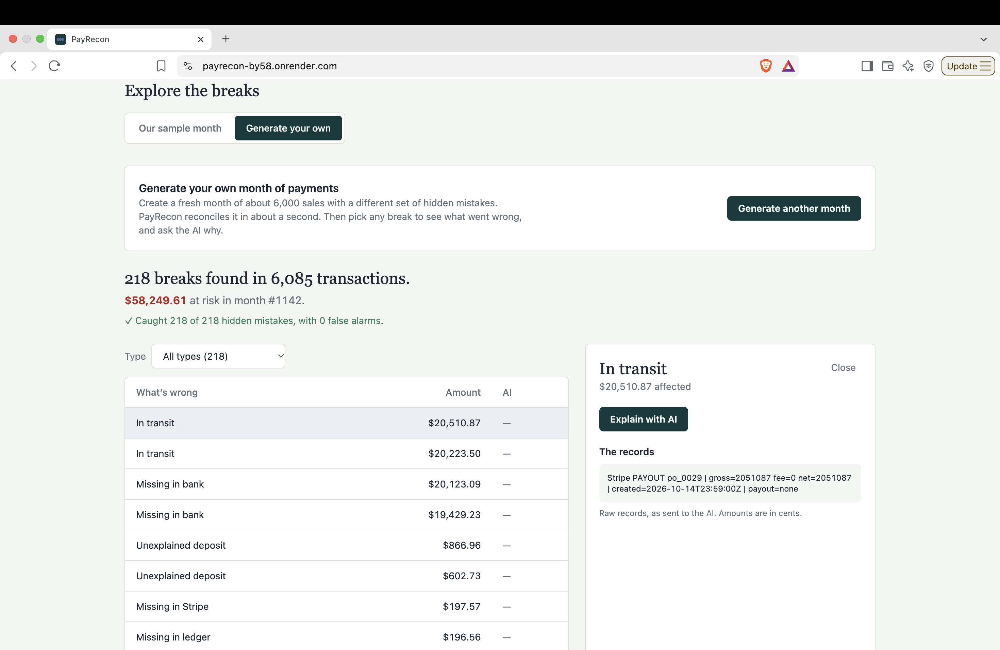

# PayRecon

**Checks that Stripe, the company's books, and the bank all agree on every payment, and uses AI to explain every mismatch.**

🔗 **Live demo:** [payrecon-by58.onrender.com](https://payrecon-by58.onrender.com) *(free hosting: the first load can take about a minute)*




## Why

Every online sale is recorded in three places: **Stripe**, the company's **ledger**, and the **bank**. They should always agree, but lost webhooks, duplicate writes, and failed payouts make them drift apart. Finance teams usually find these mismatches by hand.

## How it works


1. **Match:** each Stripe charge to the ledger by ID, and each daily payout to a bank deposit by amount and date.
2. **Find breaks:** missing, duplicate, wrong amount, in transit, missing in bank, unexplained deposit, and more (7 types).
3. **Explain:** AI suggests a likely cause and a fix for each break. Advisory only; it never changes data.

**Try it yourself:** on the live demo, open **Generate your own** to create a fresh month of payments with a different set of hidden mistakes, reconcile it in about a second, and ask the AI to explain any break.


## Results

On a synthetic month of ~12,000 records with 122 planted breaks: **122 / 122 detected, 0 false alarms.** Every generated month is checked against its own answer key the same way.

## Design highlights

- **Money stored as integer cents**, never floating point, so matching is exact.
- **Hash-map matching** turns an O(n²) comparison into O(n).
- **The database enforces** that every record lands in exactly one result.
- **AI is a separate, optional step** (Claude via Spring AI): reconciliation works even if the AI is down, and requests are batched.
- **Stateless sandbox:** a seed fully determines each generated month, so it's rebuilt on demand instead of stored. The AI only sees server-generated data, and calls are capped per day.
- **Write endpoints are protected** by an admin token; the saved demo data is read-only to visitors.

## Testing

16 tests: unit tests for both matching passes and the admin token, plus an end-to-end test on a real PostgreSQL (Testcontainers) that asserts 122/122.

## Run locally

Needs Java 25, Node 22, Docker, and an [Anthropic API key](https://platform.claude.com).

```bash
export ANTHROPIC_API_KEY="your-key"
cd backend && ./mvnw spring-boot:run      # terminal 1
cd frontend && npm install && npm run dev # terminal 2
```

Open http://localhost:5173 and click **Run demo**.

## Known limitations

- Bank matching uses amount + date, so identical amounts close together could be mis-paired.
- No refunds or chargebacks yet.
- AI explanations are advisory and can occasionally reason imprecisely.

## Tech stack

Java 25 · Spring Boot · Spring AI (Claude) · PostgreSQL · Flyway · JUnit · Testcontainers · React · TypeScript · Tailwind · Docker
